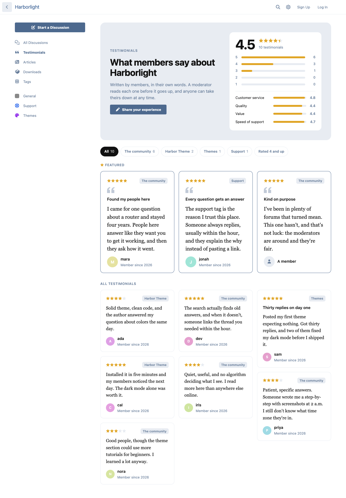
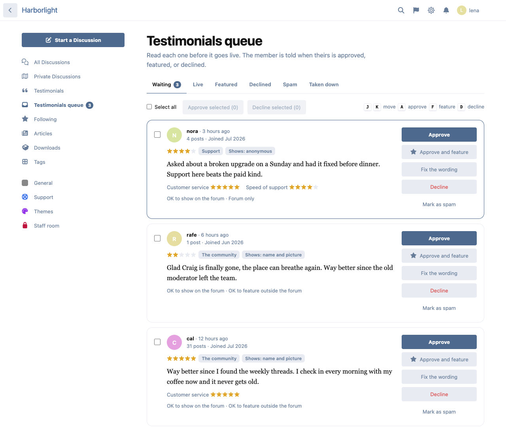
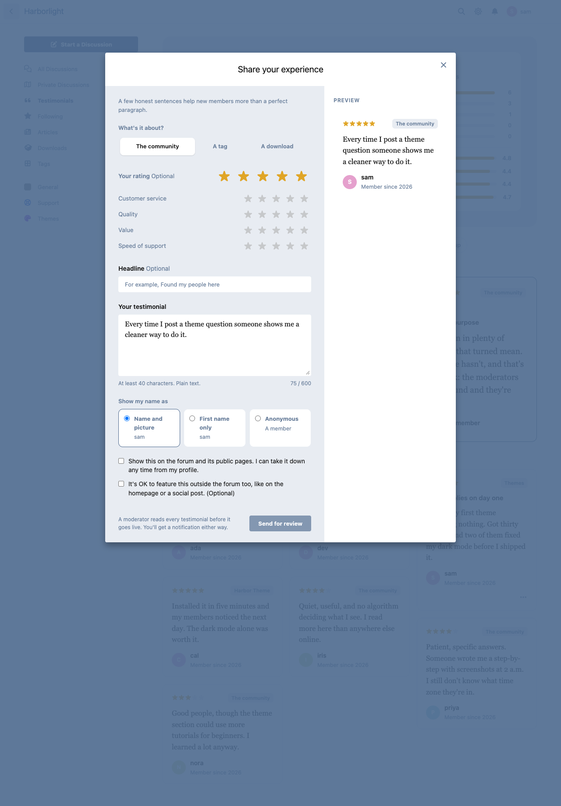
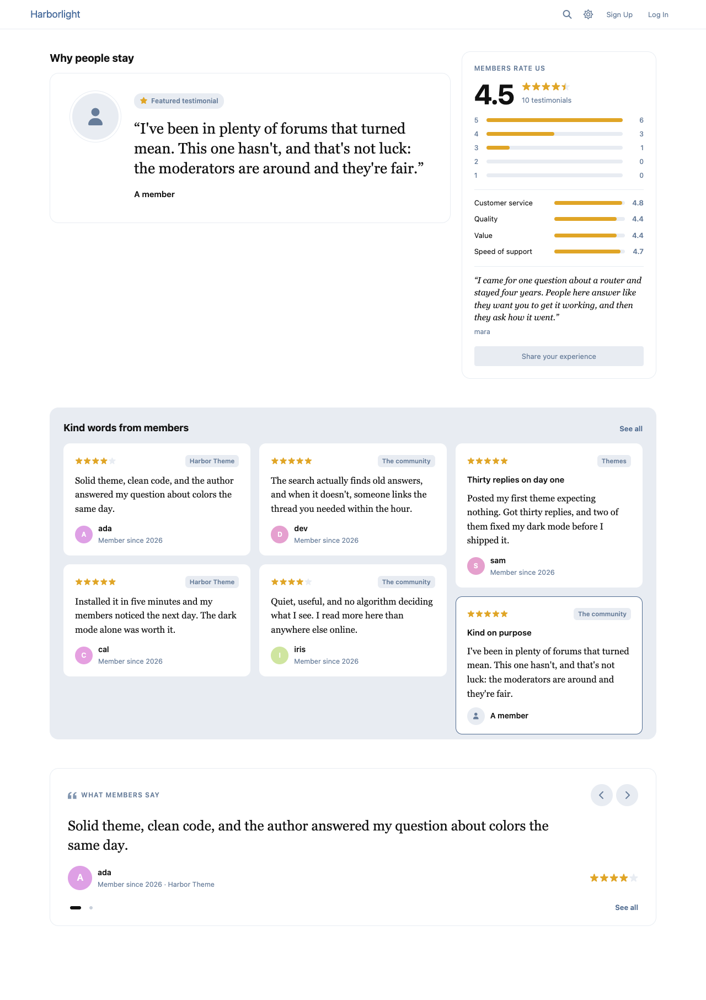

# Testimonials

What your members say about your community, a tag or a download, gathered with consent, read by a moderator, and shown as a carousel, a wall, a spotlight and a rating summary wherever your forum has room. For Flarum 2.

 [](https://packagist.org/packages/ernestdefoe/testimonials)



- **Share your experience.** Members write a few sentences, an optional headline, one to five stars, and a rating for each aspect you choose (Customer service, Quality, Value and Speed of support to start; add, rename, reorder or remove them). A preview shows the card as others will see it.
- **About something.** The community, a tag, a download ([Depot](https://ernestdefoe.online/downloads/f/depot)), or one of their own posts ("Use as a testimonial" in the post's menu starts from the post's words).
- **Their name, their choice.** Name and picture, first name only, or anonymous. Anonymous means anonymous in the API too: no name, picture, username, id or join year for anyone but moderators.
- **Consent first.** Nothing is shown without the member ticking "Show this on the forum". A second, optional box says it's OK to feature it outside the forum; that's a badge for staff, nothing is posted anywhere.
- **Moderated.** Everything waits in a queue: approve, approve and feature, fix the wording (the member is told), decline with a reason the member sees, or mark as spam. Bulk actions, and J/K/A/F/D on the keyboard. A permission lets trusted groups skip the queue.
- **Members stay in control.** Profile → Testimonials lists theirs with what happened to each. They can edit (it's read again), take it down at once, and bring it back within 30 days.
- **Depot reviews count.** With Depot, reviews rated 4 stars or more become testimonials about their download (switch it off in the settings). Reviewers never agreed to a testimonial, so these stay on the forum, are never marked OK to feature elsewhere, go when the review is edited below 4 stars or deleted, and reviewers can take theirs out of the widgets.
- **Four widgets, everywhere.** Carousel, Wall, Spotlight and Rating summary, each in [Bespoke](https://ernestdefoe.online/downloads/f/bespoke)'s zones, as [Page Builder](https://ernestdefoe.online/downloads/f/page-builder) blocks and in [FoF Widgets](https://github.com/FriendsOfFlarum/forum-widgets-core) sections, with the same settings: what to show (featured first, all, one tag, one download), how many, and the rest. Without a host, turn on a carousel above the discussion list or a rating summary in the sidebar. Narrow spots get a compact layout on their own.
- **The page.** `/testimonials`: the average, the spread, each aspect's average, a chip per subject, the featured ones, then the rest.
- **Renown.** With [Renown](https://ernestdefoe.online/downloads/f/renown), an approved testimonial earns XP.
- **Light and private.** A page of testimonials costs the same few queries however many there are. Guests share one cached rating summary, rebuilt on any change. Widgets load after the page is drawn, share their requests, and the page, queue and form load only when opened. Themes and dark mode carry through: every colour comes from Flarum's own.







## Install

```sh
composer require ernestdefoe/testimonials
```

## Update

```sh
composer update ernestdefoe/testimonials
php flarum cache:clear
```

## Links

- [Packagist](https://packagist.org/packages/ernestdefoe/testimonials)
- [GitHub](https://github.com/ernestdefoe/testimonials)
- [Buy me a coffee](https://buymeacoffee.com/ernestdefoe)
